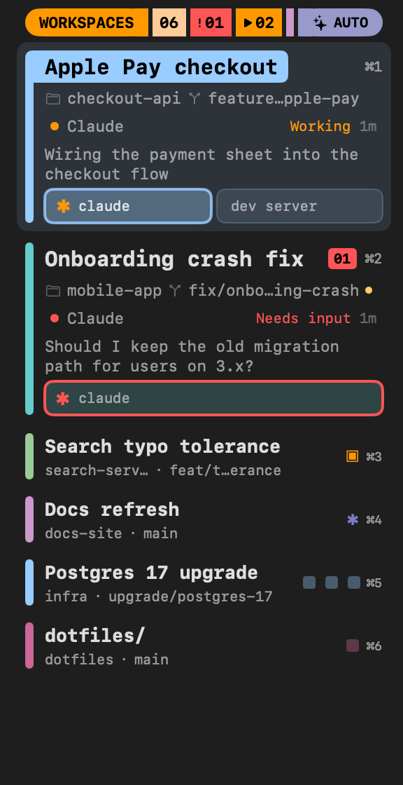
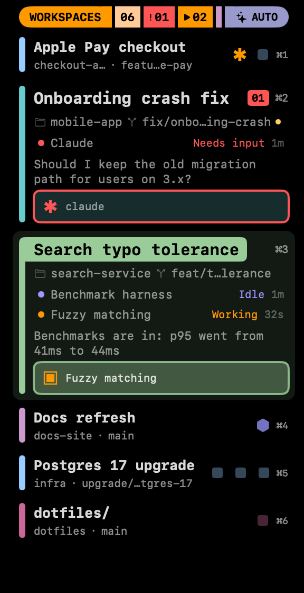

# lcars

A custom sidebar for [cmux](https://cmux.com) that shows every workspace as a
card: its name, folder and git branch, what its coding agents are doing, and a
row of tiles for its terminals. Workspaces that need you expand on their own.



## Install

### Ask your agent

Paste this to Claude Code, OpenCode or any coding agent running in cmux:

> Install the lcars cmux sidebar: clone
> `https://github.com/blaisethompson/lcars` and follow its AGENTS.md.

The agent installs the sidebar, makes it your left sidebar, and asks before
setting up the optional OpenCode integration.

### By hand

```sh
git clone https://github.com/blaisethompson/lcars.git
cd lcars
./install.sh --select
```

`./install.sh` without `--select` only installs it; pick it later with
`cmux sidebar select lcars` or from the sidebar button's right-click menu.
Add `--theme` to also install the [terminal theme](#terminal-theme-optional).

## What it shows

Each workspace is a card with its own colour bar down the left side: the
colour you set in cmux, or else lavender, ice, mauve, teal or sage. Red, amber,
periwinkle and gold are kept for status:

- **Name**, with a pin icon when pinned and a red unread-count readout. A
  workspace still named after its path shows as its folder, like `orders/`.
- **Folder and branch**, the branch in grey, with a gold dot when
  the working tree has uncommitted changes.
- **Agent status**: every live agent session gets its own row, even when
  there is only one: a dot, its name, then its status and age on the right.
  The colour is the status: red *Needs input*, amber *Working*, dimmer amber
  *Quiet* (see below), periwinkle *Idle*.
- **Last agent message**.
- **Terminal tiles**: one line per terminal with the agent's mark, the
  terminal's name and an unread dot. The shape of the mark says which agent
  it is: ✱ Claude, ▣ OpenCode, ◆ anything else. Its colour is the status,
  and it turns while the agent works. OpenCode's "OC | " title prefix is
  left off the name. A tile that needs input gets a red border instead of the
  unread dot, and the focused terminal is highlighted.

Compact rows show the name, then folder and branch below it. The
marks sit at the right in fixed slots, so they line up in columns from row
to row. With more than three terminals the last slot shows "+N" for the ones
not shown. The ⌘ number hint is aligned after them.

Claude Code doesn't report an interrupted turn (Esc), so cmux keeps such an
agent *Working* until your next prompt. Agents report on every tool call, so
after two minutes without a report lcars stops the mark turning and shows
*Quiet 2m* in dimmer amber. It never calls the agent idle, because a long
build or a long reply is silent too; the mark turns again at the next tool
call.

Click a card to switch to it, click a tile to jump to that terminal, drag
cards to reorder them, and right-click for pin, mark read, move and close.

**Close…** turns the card into a "Close <name>?" row: ↩ puts the card back,
the red × closes the workspace. It asks every time because a sidebar can't
tell whether a workspace has something running, and the confirmed close ends
any running processes, like closing from cmux's own sidebar.

### Header

The header shows the workspace count, then two readouts that appear only
while their count is above zero: a red **!NN** for agents needing input
(click it to jump to the first workspace with one) and an amber **▶NN** for
agents working right now (quiet ones aren't counted). With no workspaces the
list reads "NO WORKSPACES".

### Modes

The button at the top right cycles through:

- **Auto** (default): workspaces are compact two-line rows, and the current
  workspace plus any that need you (unread notifications or an agent waiting
  for input) expand into full cards.
- **List**: every workspace is a two-line row.
- **Full**: every workspace is a full card.

The mode resets to Auto when cmux reloads the sidebar.

## OpenCode (optional)

Claude Code reports its status to cmux out of the box. OpenCode needs cmux's
plugin first:

```sh
./install.sh --opencode
```

then restart OpenCode. This runs `cmux hooks opencode install` and moves aside
two duplicate plugin files it also writes, which OpenCode v2 otherwise lists
as failed with "Duplicate plugin ID: cmux.server". They go to
`~/.config/opencode/plugins-disabled/`.

It also patches the plugin (`opencode/cmux-tui.patch`) to fix two gaps:

- **Closed tabs linger.** cmux's plugin only ends a session when you delete or
  archive it, so every tab you closed and every OpenCode you quit stayed in
  the sidebar as *Idle*. The patch ends a session once it has been out of
  every OpenCode tab for two seconds, announces it again if you reopen it,
  announces the tabs OpenCode restores when it starts, and ends the open ones
  when OpenCode exits.
- **Tabs have no names.** cmux has nowhere to keep an OpenCode session's
  name, so the patch writes the open tabs' names into the workspace
  description as `lcars-tabs {"<session id>": "<tab name>", …}`, and lcars
  shows them on the session lines. lcars never displays the description, but
  other cmux sidebars do, so you'd see that text there. A description you set
  yourself is left alone; that workspace's tabs are then numbered instead.

A cmux update that reinstalls the plugin drops the patch: run
`./install.sh --opencode` again. If cmux changes the plugin so the patch no
longer fits, the installer says so and leaves the plugin unpatched.

lcars also hides OpenCode sessions in a terminal whose title no longer starts
with "OC |", which covers sessions left over from before the patch.



What to expect:

- **OpenCode tabs show their names**, updated when you rename a tab. Without
  the patch, or with your own workspace description, they show as "Tab 1",
  "Tab 2", in an order that may not match OpenCode's.
- **Clicking a tab line can't switch OpenCode's tab.** It jumps to the
  terminal OpenCode runs in; tabs live inside OpenCode.
- **A session opened from OpenCode's session list shows no status** until
  OpenCode restarts. New sessions, tabs OpenCode restores at launch, and
  closed tabs you reopen all work.

For the best result, run **one OpenCode session per cmux terminal** instead of
using OpenCode's tabs: press ⌘T (new terminal) or ⌘D (split), then run
`opencode`. Each session then gets its own tile, named after the session, and
clicking it takes you straight there.

To remove it again, see [Uninstall](#uninstall).

## Terminal theme (optional)

lcars comes with a matching terminal colour theme: a black background, peach
text, and the sidebar's colours for the terminal's ANSI colours. It changes how
every cmux terminal looks, so it is off unless you ask for it:

```sh
./install.sh --theme
```

This copies `theme/LCARS` to `~/.config/ghostty/themes/LCARS` (backing up a
different existing file) and runs `cmux themes set LCARS`, which applies it to
both light and dark mode and reloads open terminals. To switch back, run
`cmux themes clear`, or `./install.sh --uninstall`.

A sidebar can't theme cmux's own tab bar. If you want cmux's highlights (the
attention ring, the pane flash) in the same orange, set `app.accentColor` in
`~/.config/cmux/cmux.json`:

```jsonc
{
  "app": {
    "accentColor": "#FF9900"
  }
}
```

The installer never touches that file. Back it up first, merge the setting
into what you have, then run `cmux reload-config`.

## Uninstall

From a clone of this repo:

```sh
./install.sh --uninstall
```

This removes the sidebar, reverts the OpenCode plugin patch, and clears the
OpenCode tab names kept in workspace descriptions (yours are left alone). If
the LCARS terminal theme is set, it runs `cmux themes clear` (which resets both
light and dark) and deletes `~/.config/ghostty/themes/LCARS` unless you have
edited it. It never touches `cmux.json`.
Add `--opencode` to also remove cmux's OpenCode integration. Then choose
another sidebar from the sidebar button's right-click menu and restart
OpenCode. An agent can do this too: ask it to uninstall lcars following
AGENTS.md.

## Credits

Inspired by the minimap sidebar in [montty](https://github.com/tednaleid/montty)
by Ted Naleid.
